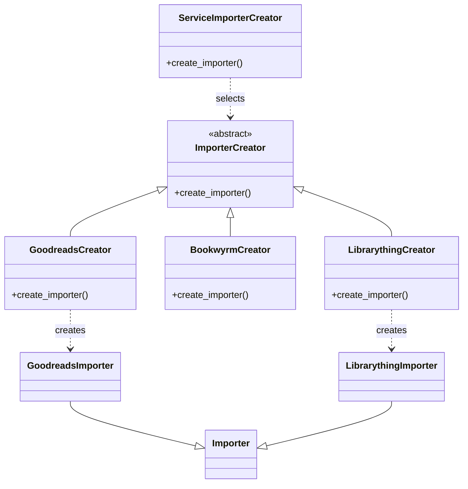

# Factory Method Pattern

Implemented in bookwyrm/importers/importer_factory.py.

ImporterCreator defines the factory method. Concrete creators return the appropriate importer. ServiceImporterCreator selects the creator based on the import source.

